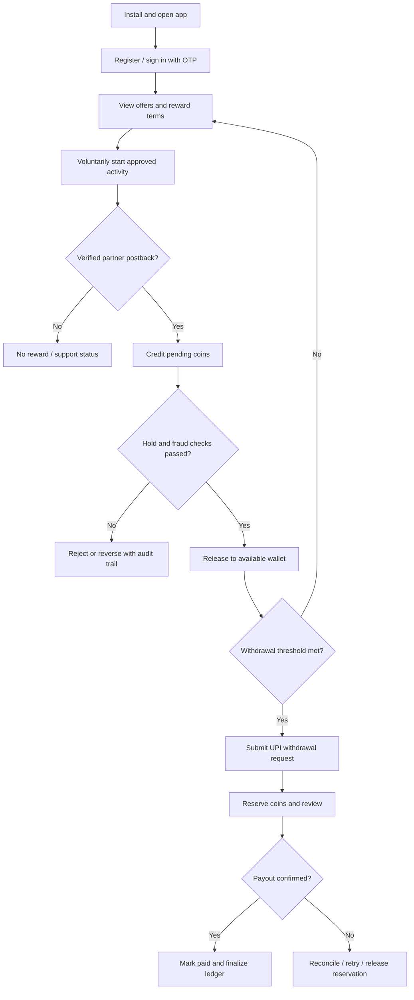
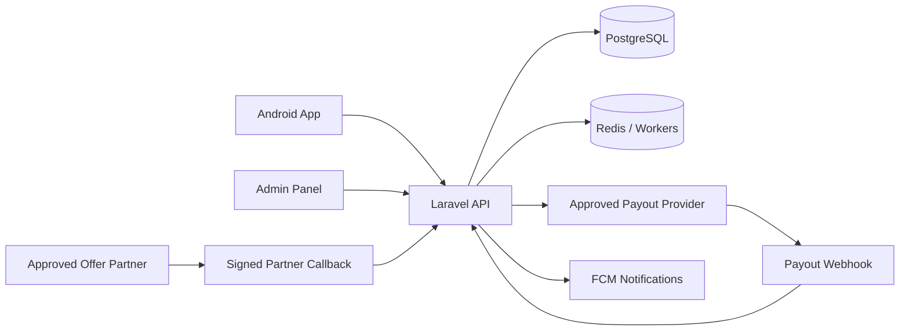

# Watch & Earn 🪙

> **Project status:** Planning / MVP specification  
> **Platform:** Android app, REST API, web admin panel, and optional marketing website  
> **Initial market:** India (18+; subject to legal, payment-provider, and app-store approval)

Watch & Earn is a proposed rewards platform where users can voluntarily complete **eligible advertiser-sponsored activities** and receive virtual coins. Once rewards are independently verified and become available, users may request withdrawals through an approved payment partner.

**Important launch gate:** The cash-redemption business model must be approved by the chosen advertising/offerwall partner, payment provider, and relevant distribution channels. **Do not use Google AdMob rewarded ads to award cash, gift cards, or coins convertible to cash.** AdMob's rewarded-ad policy requires non-transferable, non-monetary rewards. This repository specification is **not proof of Google Play eligibility**.

## Table of contents

1. [Product objectives](#1-product-objectives)
2. [Reward and coin rules](#2-reward-and-coin-rules)
3. [Business model and economics](#3-business-model-and-economics)
4. [User journey](#4-user-journey)
5. [MVP features](#5-mvp-features)
6. [Admin panel](#6-admin-panel)
7. [Technology stack](#7-technology-stack)
8. [System architecture](#8-system-architecture)
9. [Data model](#9-data-model)
10. [API design](#10-api-design)
11. [Reward verification and wallet accounting](#11-reward-verification-and-wallet-accounting)
12. [Withdrawals](#12-withdrawals)
13. [Fraud prevention and security](#13-fraud-prevention-and-security)
14. [Compliance and policy checklist](#14-compliance-and-policy-checklist)
15. [Suggested repository structure](#15-suggested-repository-structure)
16. [Local development plan](#16-local-development-plan)
17. [Testing and acceptance criteria](#17-testing-and-acceptance-criteria)
18. [Delivery roadmap](#18-delivery-roadmap)
19. [KPIs](#19-kpis)
20. [Open decisions](#20-open-decisions)
21. [References](#21-references)

---

## 1. Product objectives

- Provide a transparent way to earn virtual coins for **opt-in, verified, permitted sponsored activities**.
- Display earned, pending, reversed, reserved, and withdrawable balances accurately.
- Convert coins into Indian rupees using a fixed, clearly disclosed rate.
- Support secure withdrawal requests and clear payment status tracking.
- Give administrators tools to manage partners, rewards, user accounts, compliance, fraud, reconciliation, and support.
- Maintain sustainable unit economics; avoid funding rewards using unverifiable or invalid ad activity.

### Non-goals for MVP

- Guaranteed earnings, unlimited ads, or guaranteed availability of offers.
- Rewarding ad clicks, fake impressions, background playback, auto-viewing, or incentivized activity prohibited by a partner.
- Blockchain tokens, crypto withdrawals, pay-to-earn investments, gambling, chance-based payouts, or entry fees.
- Automated referral payouts before fraud checks and explicit partner approval.

## 2. Reward and coin rules

### Fixed exchange rate

```text
100 coins   = ₹0.10
1,000 coins = ₹1.00
10,000 coins = ₹10.00
100,000 coins = ₹100.00

INR = coins / 1,000
coins = INR * 1,000
```

All coin amounts are **nonnegative integers**. Store money in integer **paise** (not floating-point rupees):

```text
paise = coins / 10
```

Only process withdrawals when the coin amount is divisible by **10**, so paise remain integral. A ₹10 withdrawal therefore costs exactly **10,000 coins** (1,000 paise).

### Proposed initial configuration (editable in admin)

| Setting | Default | Notes |
|---|---:|---|
| Coin-to-INR conversion | 1,000 coins = ₹1 | Fixed product rate |
| Standard eligible completed ad reward | 20 coins | **Example only**; requires provider approval and viable revenue |
| Standard ad completion cap | 10 per day | Partner inventory may be lower; caps enforced server-side |
| Maximum standard ad coins per day | 200 coins | 10 × 20; excludes separately approved offer types |
| Minimum withdrawal | 10,000 coins (₹10) | Subject to payout provider limits and fees |
| Initial eligible audience | India, 18+ | Subject to verification and compliance |
| Currency and payment rail | INR / supported UPI payout | Provider approval required |

At the example settings, 10 eligible activities per day produce **200 coins = ₹0.20**. Over 30 days, the illustrative total is **6,000 coins = ₹6**, assuming all activities are available and approved. Never market hypothetical rewards as guaranteed income.

### Wallet balance types

- **Pending:** reward reported but not yet released after verification/hold period.
- **Available:** verified, withdrawable coins.
- **Reserved:** available coins locked for a pending withdrawal request.
- **Paid:** coins consumed by completed withdrawals (tracked in ledger/history).
- **Reversed:** invalidated rewards handled using compensating ledger entries; no record deletion.

## 3. Business model and economics

**Potential revenue sources** (subject to separate approval for cash-redeemable incentives):

1. Approved rewarded/sponsored placements from partners that explicitly allow cash-redeemable rewards.
2. Verified offerwall tasks or surveys that contractually permit user payouts.
3. Direct sponsored campaigns with verified engagement and lawful, transparent reward terms.

**Do not assume a network allows the model just because it has rewarded ads.** Obtain written policy and commercial approval for the *exact* user flow and reward redemption mechanism before launch.

### Example unit economics — assumptions, not forecasts

```text
Eligible verified activities:         1,000
Example partner revenue per 1,000:    ₹100.00
Example coin reward per activity:     20 coins (₹0.02)
Total example user reward expense:    ₹20.00
--------------------------------------------
Remaining before other costs:         ₹80.00
```

Real margins must account for fill rate, disallowed activity, revenue adjustments, payout processing fees, refunds/chargebacks, taxes, infrastructure, KYC, customer support, and fraud losses.

**Release rule:** Never promise a reward value that cannot be supported by the approved provider's actual settlement terms. Monitor estimated **and confirmed** revenue separately.

## 4. User journey



The mobile UI must not determine task completion or directly increase withdrawable balances.

## 5. MVP features

### Authentication and account

- Mobile number OTP sign-up/login with rate limits and abuse checks.
- Profile, age/eligibility acknowledgement, consent management, logout, account deletion request.
- Device/session history and optional step-up verification for withdrawals.

### Home

- Available coin balance, rupee equivalent, pending coins, daily activity summary.
- Available sponsored activities and daily limits.
- Transparent rewards table, eligibility conditions, and no-income-guarantee disclosure.

### Earn

- Partner-approved offer listing with task description, reward, availability, and rules.
- User-initiated launch only; clearly disclose the partner and sponsored nature.
- States: `available`, `started`, `pending`, `approved`, `rejected`, `reversed`.
- A support flow for missing rewards with partner activity reference.

### Wallet

- Balance summary and immutable transaction history.
- Reward sources, status, timestamps, and reversals.
- Clear conversion at **1,000 coins = ₹1**.

### Withdrawals

- Eligibility and minimum withdrawal checks.
- Collect only supported payout information; store sensitive details securely.
- Show `requested`, `under_review`, `processing`, `paid`, `failed`, or `cancelled`.
- Never label a transfer successful until the payout provider confirms it and reconciliation succeeds.

### Support and trust

- FAQ, contact/support tickets, missing reward dispute, payout issue reporting.
- Privacy policy, terms, reward terms, account deletion, and data handling disclosures.

### Optional website (HTML, CSS, JavaScript only)

- Landing page introducing the app and how rewards work.
- Explain conversion rate and transparent example earnings.
- Link to the app when distribution is approved; include privacy policy and contact page.
- **No fake testimonials, guaranteed-income claims, or deceptive install buttons.**

## 6. Admin panel

| Module | Capabilities |
|---|---|
| Overview | Users, activity completions, pending reward liability, available balance liability, payouts, confirmed revenue |
| Users | Search, inspect status, restrict account, verify appeals, view fraud flags |
| Partner integrations | Credential/config references, callback diagnostics, signature validation errors |
| Offers and rules | Reward rates, daily caps, campaign availability, pause controls |
| Wallet ledger | Audit transactions, investigate reversals, reconcile liabilities |
| Withdrawals | Review, approve/reject, retry safely, reconcile external transfer IDs |
| Risk and fraud | Duplicate events, device/account patterns, velocity, suspicious activity |
| Reports | Revenue by partner, verified vs rejected events, payout expense, net contribution |
| Support | Missing reward cases, payout disputes, support ticket status |
| System settings | Maintenance mode, consent versions, payout pause, feature flags |

Every manual coin adjustment and withdrawal action must store **administrator ID, reason, timestamp, and audit record**. Apply role-based access control.

## 7. Technology stack

| Component | Proposed technology |
|---|---|
| Android | Kotlin, Jetpack Compose, MVVM, Retrofit/OkHttp |
| Backend | PHP 8.3+ / Laravel 12, REST JSON API |
| Database | PostgreSQL |
| Queues / cache | Redis + Laravel queues |
| Admin panel | Laravel Filament |
| Authentication | OTP provider + signed short-lived tokens |
| Notifications | Firebase Cloud Messaging |
| Integrity checks | Android Play Integrity API + server-side risk controls |
| Payouts | Approved provider supporting INR/UPI payouts and webhook status |
| Marketing website | HTML5, CSS3, vanilla JavaScript |
| Deployment | HTTPS, managed secrets, separate staging/production environments |

Provider SDKs must be selected **after** legal/policy and technical validation. Technology choices can change during implementation.

## 8. System architecture



**Trust boundaries:**

- The Android app displays offers and sends user requests. It cannot grant coins.
- Verified partner server-to-server callbacks are the source of reward-completion truth.
- The backend applies rate limits, caps, hold periods, risk checks, and atomic ledger operations.
- Payout webhooks update payment status only after signature verification and reconciliation.

## 9. Data model

Suggested tables (names may change during migrations):

| Table | Purpose and important columns |
|---|---|
| `users` | `id`, `phone_hash`, `status`, `created_at` |
| `user_profiles` | `user_id`, `display_name`, `country`, `age_eligibility_status` |
| `devices` | `id`, `user_id`, `integrity_status`, `last_seen_at` |
| `partners` | `id`, `name`, `status`, `callback_config_ref` |
| `offers` | `id`, `partner_id`, `external_offer_id`, `reward_coins`, `terms`, `status` |
| `reward_events` | `id`, `partner_id`, `external_event_id`, `user_id`, `offer_id`, `status`, `received_at` |
| `wallet_accounts` | `id`, `user_id`, `account_type`, `currency` |
| `ledger_entries` | `id`, `transaction_id`, `account_id`, `direction`, `coin_amount`, `created_at` |
| `wallet_transactions` | `id`, `kind`, `reference_type`, `reference_id`, `idempotency_key`, `created_at` |
| `withdrawals` | `id`, `user_id`, `coins`, `amount_paise`, `status`, `payout_id` |
| `payout_methods` | `id`, `user_id`, `provider_token_ref`, `verified_at` |
| `fraud_signals` | `id`, `user_id`, `event_id`, `signal_type`, `severity` |
| `support_tickets` | `id`, `user_id`, `category`, `status` |
| `admin_audit_logs` | `id`, `admin_id`, `action`, `target_id`, `reason`, `created_at` |

### Ledger invariants

- Store reward balances as **integer coins**. Do not use floats for wallet math.
- Use balanced, append-only ledger entries (double-entry accounting or equivalently rigorous auditable accounting).
- Enforce uniqueness for `(partner_id, external_event_id)`.
- Enforce unique withdrawal idempotency keys and unique external payout references where appropriate.
- Every balance transition runs inside a database transaction with row locking or equivalent concurrency control.
- **Never** mutate or delete completed financial records to hide a reversal; add compensating entries.
- Keep an auditable distinction between pending, available, reserved, paid, and reversed balances.

## 10. API design

All endpoints are examples and should be versioned, authenticated, and validated.

| Method | Endpoint | Purpose |
|---|---|---|
| `POST` | `/api/v1/auth/otp/request` | Request OTP with abuse controls |
| `POST` | `/api/v1/auth/otp/verify` | Verify OTP and start session |
| `GET` | `/api/v1/me` | Current user profile and status |
| `GET` | `/api/v1/offers` | Fetch permitted, available offers |
| `POST` | `/api/v1/offers/{id}/start` | Create signed server-side offer session if required |
| `GET` | `/api/v1/activities` | Recent activity status |
| `GET` | `/api/v1/wallet` | Available, pending, reserved, INR equivalent |
| `GET` | `/api/v1/wallet/transactions` | Paginated wallet ledger view |
| `POST` | `/api/v1/withdrawals` | Request eligible UPI payout |
| `GET` | `/api/v1/withdrawals` | Payout history and statuses |
| `POST` | `/api/v1/support/tickets` | Open support case |
| `POST` | `/api/v1/webhooks/partners/{partner}` | Verified partner reward callback |
| `POST` | `/api/v1/webhooks/payouts/{provider}` | Verified payout status callback |

**Admin routes** should live behind dedicated authentication, RBAC, MFA where feasible, and detailed audit logging.

### Example wallet response (illustrative)

```json
{
  "coin_rate": { "coins": 1000, "inr_paise": 100 },
  "pending_coins": 200,
  "available_coins": 10100,
  "reserved_coins": 0,
  "available_inr_paise": 1010,
  "minimum_withdrawal_coins": 10000
}
```

## 11. Reward verification and wallet accounting

1. User explicitly chooses an activity and sees its terms.
2. Backend creates any required signed offer session and binds it to a user.
3. Activity is performed inside the approved integration flow.
4. Partner sends server-to-server completion event.
5. Backend verifies partner authentication/signature, timestamp, allowed source, campaign and user mapping.
6. Backend checks event idempotency, daily caps, offer eligibility, suspicious activity, and partner reversal status.
7. A single atomic operation records the verified event and credits **pending** coins.
8. Coins become **available** only after any configured settlement/hold period and risk checks.
9. If partner later reverses or invalidates an event, create compensating ledger entries and apply the documented negative-balance/debt policy where needed.

**Never reward:** app-side timer expiration alone, user screenshots, ad clicks, client-supplied `completed=true`, or repeated postback requests.

## 12. Withdrawals

### Requirements

- Age, region, identity, and payout-provider eligibility satisfied.
- Sufficient **available** balance and minimum coin threshold reached.
- Conversion produces integral paise and is calculated by backend.
- The same withdrawal is never submitted or paid twice.
- The user sees fees, delays, hold periods, and possible rejection reasons before confirmation.

### State machine

```text
requested -> under_review -> approved -> processing -> paid
               |              |            |
            rejected       cancelled     failed / reconciling
```

A successful **reservation** atomically transfers available coins to reserved coins. On confirmed payment, finalize the reserved debit. On permanent failure/cancellation, release reserved coins exactly once. Unknown payout statuses require reconciliation rather than blind retries.

### Example calculation

```text
Withdrawal request: 10,000 coins
Coin conversion:    1,000 coins = ₹1
Withdrawal amount:  ₹10.00 = 1,000 paise
```

Any provider fees, taxes, withholding, KYC, or payout eligibility must be evaluated, disclosed, and modeled before enabling live withdrawals.

## 13. Fraud prevention and security

- Server-side partner callbacks with provider-specific signature verification, time windows and replay prevention.
- OTP request limits, account/session limits, and withdrawal velocity limits.
- Play Integrity checks and risk scoring (do not treat a single device signal as definitive proof of fraud).
- Monitor device/account farms, emulator abuse, suspicious completion patterns and repeated payout identifiers.
- Avoid collecting sensitive fingerprints or identifiers without appropriate legal basis and disclosure.
- TLS everywhere; secrets in environment/secret manager; never commit credentials.
- Encrypt payout data; prefer provider tokenization to storing raw financial details.
- Password/MFA protection for admins; least-privilege roles; immutable audit logs.
- Database transactions, idempotency keys, background job retry limits and reconciliation jobs.
- Manual review and user appeals before irreversible punitive actions when appropriate.
- Backups, restore drills, monitoring, alerting, retention/deletion procedures.

## 14. Compliance and policy checklist

> **Do not begin production monetization or promise users cash rewards until these are verified.** Get professional legal/compliance review where needed.

- [ ] Obtain **written advertising-partner approval** for cash-convertible rewards and the exact offer types.
- [ ] Confirm partner contracts, invalid-traffic rules, settlement delays, reversal rights, and reward caps.
- [ ] **Exclude AdMob rewarded ad inventory from the cash-convertible rewards path.** AdMob rewards must not be cash, gift cards, or cash-convertible coins.
- [ ] Review current Google Play developer policies against the complete app and distribution model; **approval is not guaranteed**.
- [ ] Confirm payout provider supports the exact use case, UPI payouts, KYC requirements, settlement, and refunds.
- [ ] Review Indian law and relevant privacy, consumer protection, tax, advertising, payment and identity-verification obligations.
- [ ] Publish accurate Privacy Policy, Terms of Service, Reward Terms, and account/data deletion workflow.
- [ ] Provide clear consent, support contact, dispute handling, Data Safety declarations, and age restrictions.
- [ ] Avoid deceptive income claims or artificially generating paid ad impressions.
- [ ] Test provider reversals and withdrawal reconciliation before any public beta.

**Alternative product option:** If the cash-reward model cannot be approved, build a separate **non-redeemable in-app coin** system; do not suggest those coins have a cash value.

## 15. Suggested repository structure

```text
watch-and-earn/
├── README.md
├── docs/
│   ├── product-requirements.md
│   ├── partner-compliance.md
│   ├── api-contract.md
│   ├── database-schema.md
│   ├── threat-model.md
│   └── deployment.md
├── app/
│   └── android/                      # Kotlin + Jetpack Compose Android app
│       ├── app/
│       └── build.gradle.kts
├── web/
│   ├── website/                      # HTML / CSS / JavaScript landing site
│   │   ├── index.html
│   │   ├── css/
│   │   └── js/
│   ├── backend/                      # Laravel REST API & Admin web portal
│   │   ├── app/
│   │   ├── database/migrations/
│   │   ├── routes/api.php
│   │   └── tests/
│   └── admin/                        # Operations manual & admin runbook
├── assets/                           # Shared brand identity & iconography
├── design_screens/                   # Visual specs & high-res mockups
└── .github/workflows/
```

The structure is **proposed**. No source code, migrations, or credentials are included in this README.

## 16. Local development plan

### Prerequisites

- Android Studio with a suitable Android SDK.
- JDK version compatible with the selected Android/Gradle toolchain.
- PHP, Composer, PostgreSQL, Redis, and Node.js as needed for Laravel/Filament assets.
- Approved sandbox credentials for an offer partner and payout provider.

### Implementation order

1. Create backend + PostgreSQL migrations and automated ledger tests.
2. Implement OTP authentication, user eligibility, and wallet read APIs.
3. Add a **mock reward provider** to test callbacks without generating real paid impressions.
4. Implement authenticated signed partner webhooks, event deduplication, holds, and reversal handling.
5. Build Android Home, Earn, Wallet, History, and Withdraw screens.
6. Implement payout state machine using provider **sandbox** and webhook verification.
7. Build Filament admin views, audit logs, fraud rules, and support cases.
8. Complete privacy/security checks, monitoring, and automated CI tests.
9. Only after written approvals, swap approved sandbox integrations for production credentials.

### Configuration example

```dotenv
APP_ENV=local
APP_DEBUG=true
APP_URL=http://localhost:8000
DB_CONNECTION=pgsql
QUEUE_CONNECTION=redis
CACHE_STORE=redis

COINS_PER_INR=1000
STANDARD_REWARD_COINS=20
STANDARD_DAILY_LIMIT=10
MIN_WITHDRAWAL_COINS=10000

REWARDS_PROVIDER_MODE=mock
PAYOUT_PROVIDER_MODE=sandbox
```

These environment variables are conceptual until added to the real backend. Keep signature verification keys, OTP credentials, and payout API secrets out of Git.

## 17. Testing and acceptance criteria

### Rewards

- [ ] One valid signed partner event grants coins **once**, even when delivered repeatedly.
- [ ] Invalid signature, expired event, unknown user, or invalid offer grants **zero** coins.
- [ ] Duplicate events are idempotent and audited.
- [ ] Pending coins do not become withdrawable before release.
- [ ] Daily/offer limits cannot be bypassed by device changes or parallel requests.
- [ ] Late reversals generate compensating entries and support investigation.

### Wallet and payouts

- [ ] `1,000 coins = ₹1`, `10,000 coins = ₹10` in all screens and APIs.
- [ ] Insufficient balance or ineligible user cannot request withdrawal.
- [ ] Two simultaneous requests cannot reserve/spend the same coins twice.
- [ ] Provider webhook duplicates cannot finalize a payout twice.
- [ ] Permanent payout failure releases coins only once.
- [ ] Unknown payout state triggers reconciliation; no blind duplicate transfer.
- [ ] Ledger balances reconcile to wallet balances and outstanding liabilities.

### Security and operations

- [ ] Admin-only endpoints reject normal users.
- [ ] OTP and sensitive APIs are rate-limited.
- [ ] Privacy/account deletion workflow works with applicable financial record retention rules.
- [ ] API error states and support escalation are understandable.
- [ ] All integrations tested using mocks/sandboxes, not incentivized live ad traffic.

## 18. Delivery roadmap

| Phase | Deliverable | Exit criteria |
|---|---|---|
| 0. Feasibility | Written partner + distribution + payment compliance review | Cash-reward model is feasible and approved |
| 1. Foundation | Authentication, data model, ledger, API contracts | Automated wallet/ledger tests pass |
| 2. Rewards | Android earning UI + verified partner callbacks | Signed/duplicate/reversal flows pass |
| 3. Withdrawals | Payout workflow + webhook reconciliation | Sandbox payouts reconcile exactly |
| 4. Operations | Admin portal, analytics, moderation, support | Audit trail + fraud controls tested |
| 5. Beta | Small, controlled, approved launch | Proven positive unit economics and compliant payouts |

**No public launch date is promised.** Phase 0 is a hard stop if the cash-reward model is not contractually and legally viable.

## 19. KPIs

- Daily active users (DAU), retention (D1/D7/D30), and verified completion rate.
- Partner fill rate; approved, rejected, reversed and pending events.
- Confirmed revenue per 1,000 eligible activities (not a claimed fixed amount).
- Reward cost as a percentage of confirmed revenue.
- Outstanding coin liability in INR; cash reserve coverage.
- Fraud review rate, payout success/failure/reconciliation rate.
- Average support resolution time and user complaints.
- Net contribution after rewards, reversals, fees, infrastructure and customer support.

## 20. Open decisions

1. Which advertising/offerwall partner will **explicitly permit withdrawable cash rewards**?
2. Does Google Play permit this complete app's model under its current policies, or is another lawful distribution approach necessary?
3. Which Indian payout provider approves this exact use case and what are its KYC/fee/minimum-payout requirements?
4. Will all offers pay a fixed coin amount or will reward sizes vary with advertiser revenue?
5. What is the hold period for pending coins, and how are late reversals handled?
6. What are the support SLA, appeal process and cash reserve policy?
7. Is the first public launch Android-only, with a static marketing site, or also a user-facing web app?

## 21. References

- [Google AdMob — Policies for ad units that offer rewards](https://support.google.com/admob/answer/7313578?hl=en)
- [Google Play — Developer Program Policy](https://support.google.com/googleplay/android-developer/answer/18265346)
- [Google Play — Ads policy](https://support.google.com/googleplay/android-developer/answer/9857753)
- [Google Developers — Server-side verification callback pattern (for non-cash AdMob use only)](https://developers.google.com/admob/android/ssv)

> **Disclaimer:** This README is a product and engineering plan, not legal advice, a revenue guarantee, partner approval, a confirmed Play Store publishing pathway, or a completed implementation. Validate current policies and commercial terms before building a cash-reward production flow.

---

**Watch & Earn — Transparent rewards. Verifiable activity. Secure withdrawals.**
