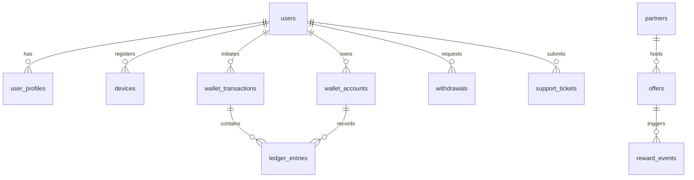

# Database Schema & Ledger Architecture

## 1. Schema Overview
The Watch & Earn database uses PostgreSQL (compatible with SQLite for local development and fast testing). It is built around an immutable double-entry ledger architecture.

## 2. Table Specifications

### `users`
- `id` (bigserial, PK)
- `phone_hash` (string, unique, index) - SHA-256 of normalized phone number
- `phone_last_four` (string(4)) - For customer display masking
- `status` (string, default 'active') - 'active', 'suspended', 'banned'
- `created_at`, `updated_at` (timestamps)

### `user_profiles`
- `id` (bigserial, PK)
- `user_id` (bigint, FK -> users.id)
- `display_name` (string, nullable)
- `country` (string(2), default 'IN')
- `age_eligibility_status` (string) - 'unverified', 'verified_18_plus', 'failed'
- `consent_version` (string)
- `consent_given_at` (timestamp)

### `partners`
- `id` (bigserial, PK)
- `name` (string)
- `slug` (string, unique)
- `secret_key` (string) - HMAC key for postbacks
- `status` (string) - 'active', 'paused'
- `callback_config` (jsonb / text)

### `offers`
- `id` (bigserial, PK)
- `partner_id` (bigint, FK -> partners.id)
- `external_offer_id` (string)
- `title` (string)
- `description` (text)
- `reward_coins` (integer) - Fixed integer coins
- `daily_cap` (integer, default 10)
- `terms` (text)
- `status` (string) - 'active', 'paused', 'expired'

### `reward_events`
- `id` (bigserial, PK)
- `partner_id` (bigint, FK -> partners.id)
- `external_event_id` (string)
- `user_id` (bigint, FK -> users.id)
- `offer_id` (bigint, FK -> offers.id, nullable)
- `reward_coins` (integer)
- `status` (string) - 'pending', 'settled', 'reversed', 'rejected'
- `signature` (string)
- `raw_payload` (jsonb / text)
- `received_at` (timestamp)
- **Constraint:** Unique `(partner_id, external_event_id)`

### `wallet_accounts`
- `id` (bigserial, PK)
- `user_id` (bigint, FK -> users.id, nullable for system accounts)
- `account_type` (string) - 'available', 'pending', 'reserved', 'system_liability', 'system_equity'
- `currency` (string, default 'COIN')
- **Constraint:** Unique `(user_id, account_type)`

### `wallet_transactions`
- `id` (bigserial, PK)
- `user_id` (bigint, FK -> users.id)
- `kind` (string) - 'reward_pending', 'reward_release', 'withdrawal_reserve', 'withdrawal_payout', 'withdrawal_refund', 'reward_reversal'
- `reference_type` (string, nullable) - 'reward_event', 'withdrawal', 'manual_adjustment'
- `reference_id` (string, nullable)
- `idempotency_key` (string, unique, index)
- `description` (string)
- `created_at` (timestamp)

### `ledger_entries`
- `id` (bigserial, PK)
- `transaction_id` (bigint, FK -> wallet_transactions.id)
- `account_id` (bigint, FK -> wallet_accounts.id)
- `direction` (string) - 'debit', 'credit'
- `coin_amount` (integer) - Always non-negative integer
- `created_at` (timestamp)

### `withdrawals`
- `id` (bigserial, PK)
- `user_id` (bigint, FK -> users.id)
- `coins` (integer) - Must be $\ge 10000$ and divisible by 10
- `amount_paise` (integer) - Exactly `coins / 10`
- `upi_id` (string)
- `status` (string) - 'requested', 'under_review', 'approved', 'processing', 'paid', 'failed', 'cancelled'
- `idempotency_key` (string, unique)
- `payout_id` (string, nullable) - Provider reference ID
- `failure_reason` (text, nullable)
- `created_at`, `updated_at` (timestamps)

### `fraud_signals`
- `id` (bigserial, PK)
- `user_id` (bigint, FK -> users.id)
- `event_id` (string, nullable)
- `signal_type` (string) - 'duplicate_ip', 'velocity_exceeded', 'integrity_failed', 'postback_replay'
- `severity` (string) - 'low', 'medium', 'high', 'critical'
- `details` (jsonb / text)
- `created_at` (timestamp)

### `support_tickets`
- `id` (bigserial, PK)
- `user_id` (bigint, FK -> users.id)
- `category` (string) - 'missing_reward', 'withdrawal_issue', 'account_query', 'other'
- `subject` (string)
- `message` (text)
- `status` (string, default 'open') - 'open', 'in_progress', 'resolved', 'closed'
- `created_at`, `updated_at` (timestamps)

### `admin_audit_logs`
- `id` (bigserial, PK)
- `admin_id` (string)
- `action` (string)
- `target_type` (string)
- `target_id` (string)
- `reason` (text)
- `details` (jsonb / text)
- `created_at` (timestamp)
